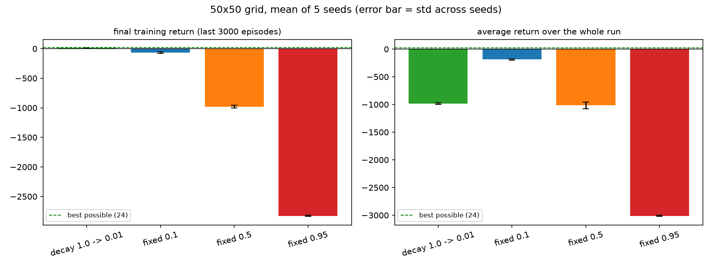

# Warehouse Bot: Epsilon Strategy Study on a 50×50 Grid

A Python simulation of a Q-learning warehouse robot that learns to pick up a package and deliver it to a bay, used to compare a decaying exploration rate against fixed exploration rates on a large grid.

## About

On a large warehouse the choice of epsilon matters: the package is far from the start, the bay is farther still, and a bot that explores too much may never learn the full route. This project trains the same tabular Q-learning agent on a 50×50 warehouse with four exploration strategies (a decaying epsilon and three fixed values) and measures how each one affects learning speed, training reward, and the final delivery route.

No neural network is involved. The agent learns a plain Q-table, which makes every learned value inspectable.

## Core Architecture

The system is split into a small number of files, each with one job:

- **Environment (`env.py`):** The 50×50 warehouse. It defines the shelves, the start cell, the package, the delivery bay, the rewards, and the step limit. It contains no learning.
- **Learning (`qlearning.py`):** The Q-table, epsilon-greedy action selection, the epsilon schedule, and the training loop.
- **Fixed-epsilon baseline (`train_fixed.py`):** Trains the same agent with a constant epsilon, for comparison against the decaying schedule.
- **Testing (`test_bot.py`, `test_bot_click.py`):** Loads a saved Q-table and plays greedily (epsilon = 0). The click version lets you choose any starting square and watch the bot deliver from there.
- **Analysis (`compare_epsilon.py`, `plot_training.py`):** Produces the comparison table, bar charts, training curves and the best-move arrow maps.
- **Drawing (`visual.py`):** Renders the grid, shelves, package, bay, bot and its trail.

## The Warehouse

| Item | Value |
|---|---|
| Grid size | 50 × 50 |
| Start cell | (0, 0) |
| Package | (12, 37) |
| Delivery bay | (49, 49) |
| Shelf cells (obstacles) | 250 (about 10% of the grid) |
| Step limit per episode | 300 |
| Number of states | 5,000 |
| Actions | Up, Down, Left, Right |

A state is `(row, column, carrying package)`. The shelf layout is generated with a fixed seed, so every run sees the same warehouse, and generation guarantees a route to the package and on to the bay always exists.

## Working Principle

1. **Act:** At each step the bot picks a move. With probability ε it explores a random move; otherwise it takes the move with the highest Q-value.
2. **Get rewarded:** The environment returns a reward for that move.
3. **Learn:** The Q-table is updated with the Q-learning rule:

$$Q(s,a) \leftarrow Q(s,a) + \alpha \left[ r + \gamma \max_{a'} Q(s',a') - Q(s,a) \right]$$

4. **Repeat:** An episode ends when the package is delivered or the step limit is reached. After many episodes the Q-values encode the shortest route.

The decaying schedule starts with ε = 1.0 (explore everything) and falls in a straight line to ε = 0.01 over the first 75% of training, then stays there. The fixed strategies keep ε constant for the whole run.

## Constants and Parameters Used

| Parameter | Symbol | Value |
|---|---|---|
| Learning rate | α | 0.1 |
| Discount factor | γ | 0.95 |
| Starting epsilon (decay run) | ε_start | 1.0 |
| Final epsilon (decay run) | ε_end | 0.01 |
| Training episodes | N | 30,000 |
| Epsilon decay length | | 22,500 episodes (75% of N) |
| Fixed epsilon values compared | | 0.1, 0.5, 0.95 |
| Random seed (default run) | | 0 |

### Rewards

| Event | Reward |
|---|---|
| Normal move | −1 |
| Hitting a wall or shelf | −100 |
| Picking up the package | +20 |
| Delivering the package | +100 |

The shortest possible route from the start to the package and on to the bay is **98 steps** (49 to the package, 49 to the bay), giving a best possible return of **24**.

## Outcome

All four strategies train for the same 30,000 episodes. The decay run is compared against fixed ε = 0.1, 0.5 and 0.95. Results are the mean of 5 seeds (± is the standard deviation across seeds).

| Metric | Decay (1.0 → 0.01) | Fixed 0.1 | Fixed 0.5 | Fixed 0.95 |
|---|---|---|---|---|
| Final training return (last 3,000 episodes) | **13.5 ± 1.9** | −66.9 ± 15.7 | −979.8 ± 25.7 | −2827.8 ± 10.6 |
| Whole-run average return | −983.2 | **−185.4** | −1016.3 | −3010.8 |
| Episode from which the moving average (300 episodes) stays above 0 | 22,352 on average (5 of 5 seeds) | never | never | never |
| Greedy test from start: delivered | 5 of 5 | 5 of 5 | 5 of 5 | 0 of 5 |
| Greedy test from start: mean steps (shortest = 98) | 98 | 98 | 98 | not delivered (300-step limit) |

**Key observations:**

- **Decay ends best:** The decay run is the only one that finishes with a positive training return (+13.5, against a best possible 24). The fixed strategies end at −66.9, −979.8 and −2827.8.
- **Fixed ε keeps paying for exploration:** Fixed 0.1 and 0.5 also learn the shortest 98-step route, but while training they keep taking random moves, which means collisions and wasted steps. Their training return does not stay positive.
- **Too much exploration fails:** With ε = 0.95 the bot does not learn a usable route. Played greedily from the start, it delivers in 0 of 5 seeds and runs into the step limit.
- **Decay is not faster early:** Decay starts at ε = 1.0, so it spends its first episodes exploring. Fixed 0.1 has the better whole-run average (−185.4 against −983.2), and the decay run only becomes profitable around episode 22,350, once ε is close to its floor. Decay trades a slow start for the best final training return.



**Note:** Training always starts the bot at (0, 0), so the Q-table is most reliable along the route from the start. Starting the bot from distant cells (using the click test) can fail in places training rarely visited.

## Getting Started

### Requirements

```
pip install -r requirements.txt
```

### Run

Run, in order:

```
python qlearning.py                 # train with decaying epsilon -> q_table.npy
python train_fixed.py               # train with fixed epsilon    -> q_fixed.npy
python test_bot_click.py            # click a square, watch the bot deliver
python test_bot_click.py q_fixed.npy
python compare_epsilon.py 5         # comparison table and chart (5 seeds)
python plot_training.py --save training_curve.png
```

## Future Scope

- Random starting positions during training, so the bot can deliver from anywhere in the warehouse.
- Multiple packages and multiple delivery bays.
- Moving obstacles such as other robots or forklifts.
- A learning-rate schedule alongside the epsilon schedule.
- Replacing the Q-table with a neural network (DQN) for larger or continuous warehouses.

## Applications

- **Warehouse and fulfilment automation:** Learning pick-and-deliver routes without hand-coded path planning.
- **Teaching reinforcement learning:** A small, fully inspectable example of how exploration strategy changes learning on larger problems.
