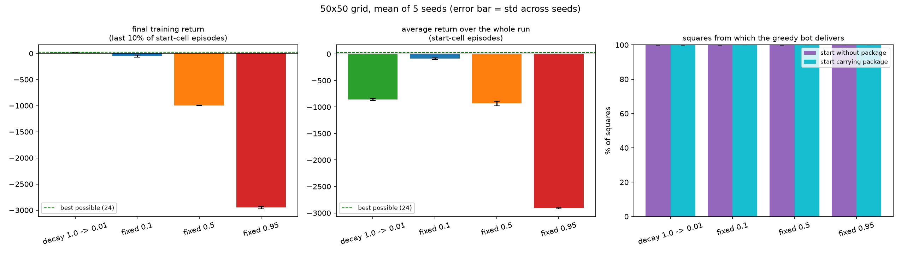

# Warehouse Bot: Epsilon Strategy Study on a 50×50 Grid

A Python simulation of a Q-learning warehouse robot that learns to pick up a package and deliver it to a bay, used to compare a decaying exploration rate against fixed exploration rates on a large grid.

## About

On a large warehouse the package is far from the start and the bay is farther still, so how the bot explores, and where each training episode begins, both matter. This project trains the same tabular Q-learning agent on a 50×50 warehouse with four exploration strategies (a decaying epsilon and three fixed values) and measures how each one affects the reward earned during training, the delivery route from the start, and the share of starting squares from which the finished bot can deliver.

## Core Architecture

The system is split into a small number of files, each with one job:

- **Environment (`env.py`):** The 50×50 warehouse. It defines the shelves, the start cell, the package, the delivery bay, the rewards, and the step limit.
- **Learning (`qlearning.py`):** The Q-table, epsilon-greedy action selection, the epsilon schedule, the starting-square mix, and the training loop.
- **Fixed-epsilon baseline (`train_fixed.py`):** Trains the same agent with a constant epsilon, for comparison against the decaying schedule.
- **Testing (`test_bot.py`, `test_bot_click.py`):** Loads a saved Q-table and plays greedily (epsilon = 0). The click version lets you choose any starting square and watch the bot deliver from there.
- **Analysis (`compare_epsilon.py`, `plot_training.py`, `check_coverage.py`):** Produces the comparison table and bar charts, the training curve and best-move arrow maps, and a check of which starting squares a saved table can deliver from.

## The Warehouse

| Item | Value |
|---|---|
| Grid size | 50 × 50 |
| Start cell | (0, 0) |
| Package | (12, 37) |
| Delivery bay | (49, 49) |
| Shelf cells (obstacles) | 250 (about 10% of the grid) |
| Step limit per episode | 300 |
| Number of states | 5,000 |
| Actions | Up, Down, Left, Right |

A state is `(row, column, carrying package)`. The shelf layout is generated with a fixed seed, so every run sees the same warehouse, and generation guarantees a route to the package and on to the bay always exists.

## Working Principle

1. **Act:** At each step the bot picks a move. With probability ε it explores a random move; otherwise it takes the move with the highest Q-value.
2. **Get rewarded:** The environment returns a reward for that move.
3. **Learn:** The Q-table is updated with the Q-learning rule:

$$Q(s,a) \leftarrow Q(s,a) + \alpha \left[ r + \gamma \max_{a'} Q(s',a') - Q(s,a) \right]$$

4. **Repeat:** An episode ends when the package is delivered or the step limit is reached. After many episodes the Q-values encode the shortest route.

The decaying schedule starts with ε = 1.0 (explore everything) and falls in a straight line to ε = 0.01 over the first 75% of training, then stays there. The fixed strategies keep ε constant for the whole run.

### Where training episodes start

A quarter of the training episodes begin at the start cell with no package. The other three quarters begin on a random free square, carrying the package or not. Starting only at the corner teaches the bot the route from the corner but little elsewhere, because a random walk rarely reaches the package and then the bay from far away. Random starting squares put the bot close to the goal more often, so the delivery reward can spread back through more of the grid. Keeping a quarter of the episodes at the start cell preserves the main route.

## Constants and Parameters Used

| Parameter | Symbol | Value |
|---|---|---|
| Learning rate | α | 0.1 |
| Discount factor | γ | 0.99 |
| Starting epsilon (decay run) | ε_start | 1.0 |
| Final epsilon (decay run) | ε_end | 0.01 |
| Training episodes | N | 100,000 |
| Epsilon decay length | | 75,000 episodes (75% of N) |
| Share of episodes starting on a random square | | 0.75 |
| Fixed epsilon values compared | | 0.1, 0.5, 0.95 |
| Random seed (default run) | | 0 |

### Rewards

| Event | Reward |
|---|---|
| Normal move | −1 |
| Hitting a wall or shelf | −100 |
| Picking up the package | +20 |
| Delivering the package | +100 |

The shortest possible route from the start to the package and on to the bay is **98 steps** (49 to the package, 49 to the bay), giving a best possible return of **24**.

## Outcome

All four strategies train for the same 100,000 episodes with the same starting-square mix. The decay run is compared against fixed ε = 0.1, 0.5 and 0.95. Results are the mean of 5 seeds (± is the standard deviation across seeds). Training returns are measured on the episodes that began at the start cell, so they can be compared with the best possible return of 24.

| Metric | Decay (1.0 → 0.01) | Fixed 0.1 | Fixed 0.5 | Fixed 0.95 |
|---|---|---|---|---|
| Final training return (last 10% of start-cell episodes) | **13.8 ± 0.4** | −50.2 ± 19.5 | −997.8 ± 6.1 | −2949.0 ± 23.1 |
| Whole-run average return (start-cell episodes) | −859.5 | **−89.0** | −935.1 | −2911.7 |
| Episode from which the moving average (500 start-cell episodes) stays above 0 | 75,083 on average (5 of 5 seeds) | never | never | never |
| Greedy test from start: delivered | 5 of 5 | 5 of 5 | 5 of 5 | 5 of 5 |
| Greedy test from start: mean steps (shortest = 98) | 98.0 | 98.0 | 98.0 | 98.0 |
| Squares that deliver, starting without the package | 99.9% | 100.0% | 99.9% | 100.0% |
| Squares that deliver, starting while carrying it | 99.9% | 100.0% | 100.0% | 100.0% |

**Key observations:**

- **All four strategies learn the same finished policy:** every one delivers from the start cell in the shortest 98 steps in all 5 seeds, and from essentially every possible starting square (99.9–100%). With this training setup, the choice of ε does not change the quality of the finished Q-table.
- **They differ in what they earn while training:** decay is the only strategy that ends training with a positive return (+13.8 ± 0.4, against a best possible 24). Fixed 0.1, 0.5 and 0.95 end at −50.2, −997.8 and −2949.0. In the last stretch these gaps mostly reflect how often each strategy still takes random moves.
- **Decay pays for its early exploration:** Fixed 0.1 has the best whole-run average (−89.0, against −859.5 for decay), and the decay return only stays above 0 from about episode 75,000, when ε reaches its floor.
- **Summary:** decay's advantage here is the return at the end of training, not a better finished policy. A low fixed ε (0.1) is the cheapest overall.



**Note:** The last two rows play the finished Q-table greedily (ε = 0) from every possible starting square and report the share from which the bot delivers.

## Getting Started

### Requirements

```
pip install -r requirements.txt
```

### Run

Run, in order:

```
python qlearning.py                     # train with decaying epsilon -> q_table.npy
python train_fixed.py                   # train with fixed epsilon    -> q_fixed.npy
python test_bot_click.py q_table.npy    # decay-trained bot: click a square, watch it deliver
python test_bot_click.py q_fixed.npy    # fixed-epsilon bot, for comparison
python compare_epsilon.py 5             # comparison table and chart (5 seeds)
python plot_training.py --save training_curve.png
python check_coverage.py q_table.npy    # share of starting squares the bot delivers from
```

The share of random-start episodes is `RANDOM_START_FRACTION` in `qlearning.py`. Setting it to 0.0 trains from the start cell only.

## Future Scope

- Moving obstacles such as other robots or forklifts.
- A learning-rate schedule alongside the epsilon schedule.
- Replacing the Q-table with a neural network (DQN) for larger or continuous warehouses.

## Applications

- **Warehouse and fulfilment automation:** Learning pick-and-deliver routes without hand-coded path planning.
- **Teaching reinforcement learning:** A small, fully inspectable example of how exploration strategy changes learning on larger problems.
